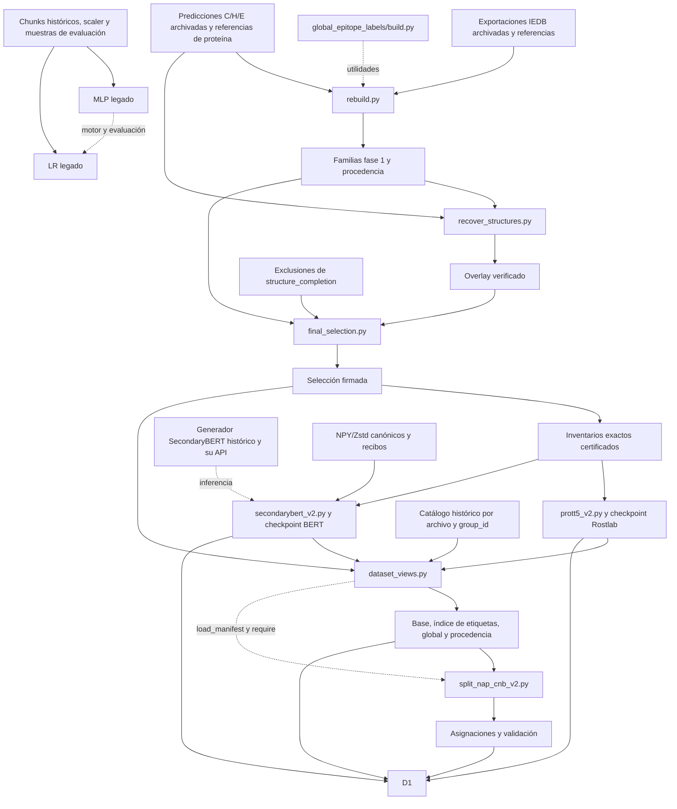

# NAP-CNB v2 · Plan de refactorización del pipeline

## Resumen ejecutivo

Recomiendo **A, reorganización mínima**. Mantener los 63 scripts en sus ubicaciones actuales y añadir, tras aprobación, una interfaz de consulta y validación de solo lectura. La propuesta requiere **un módulo nuevo** para el primer incremento. Los cambios de documentación ocuparían uno o dos README existentes. Las pruebas pueden ampliar archivos existentes y, si el contrato lo justifica, añadir un archivo de pruebas pequeño. Un paquete con varios módulos solo se justificaría si el uso de la interfaz demuestra que las responsabilidades ya no caben con claridad en ese módulo.

La primera mejora consiste en separar tres cosas que hoy aparecen juntas en documentación e imports: construir artefactos de una fase, consultar una entrega ya certificada y reproducir un experimento histórico. La configuración de D1, la semilla 42, los 49.123.503 originales y las 15.100.592 representaciones globales son contratos de la entrega existente. Los manifiestos y archivos firmados determinan los valores. El código reorganizado debe leer esos mismos insumos y devolver los mismos resultados.

Se revisaron el inventario 4E, los tres documentos de referencia, README funcionales, imports, entradas de línea de comandos, manifiestos y cobertura de pruebas. El punto de comparación de Git es `536548a` y el árbol de trabajo contiene también módulos locales de v2. Los recuentos del inventario corresponden a **10 activos, 14 de validación, 24 históricos, 2 sustituidos para el flujo v2 y 13 puntuales**. Las categorías son de función. Un componente histórico puede seguir siendo una dependencia indispensable.

[Historia técnica](NAP_CNB_technical_history.md) · [Organización de datos](nap_cnb_v2_dataset_organization.md) · [Auditoría 4E](../reports/NAP_CNB_repository_audit.md)

## 1. Estructura actual y flujo activo

| Área | Construcción o evidencia histórica | Contrato activo de consumo y validación |
|---|---|---|
| Adquisición y reconstrucción | `data_download` y `data_classification` documentan la adquisición histórica; las familias `iedb_*_audit` conservan reconciliación y fuentes | `rebuild_iedb/rebuild.py` reconstruye evidencia verificable, coordenadas, ventanas y procedencia desde fuentes archivadas y referencias. Usa `structures.py` y utilidades de `global_epitope_labels/build.py` |
| Estructuras y selección | `secondary_structure_prediction` genera o corta predicciones originales en su entorno TensorFlow; UNet-C Ensemble se carga como SavedModel | `recover_structures.py` coteja archivos archivados y publica overlay; `final_selection.py` firma las familias, overlay y exclusiones. El cierre de estructuras y el inventario de claves tienen resultados certificados, con pasos de validación registrados en los informes |
| ProtT5 | Generador histórico conserva el formato por familia. Su revisión por lote no quedó fijada | `prott5_v2.py` ofrece inventario, localización y comprobación del almacén certificado por ordinal. Lee el checkpoint Rostlab, inventario y selección para las operaciones que los requieren. La cobertura confirmada vive en SQLite |
| SecondaryBERT | El generador agrupado aporta al flujo v2 el tokenizer, carga y pooling | `secondarybert_v2.py` indexa la secundaria exacta, verifica nuevos vectores por checksum y resuelve históricos con rutas a NPY/Zstd y recibos. Su CLI actual ofrece `index`, `pilot` y `generate` |
| Vistas y etiquetas | El índice global histórico sigue siendo procedencia. Las observaciones antiguas tienen IDs locales a archivo | `dataset_views.py` combina selección y grupos históricos, coteja claves de ambos catálogos y publica base con `label_original`, vistas con `label_global` y relaciones reversibles |
| Particiones | `split_data.py` separa filas de chunks históricos y sigue siendo necesario para su reproducción | `split_nap_cnb_v2.py` usa grupos efectivos por primaria exacta y semilla 42; obtiene observaciones y grupos por procedencia y publica la asignación única. Base y global consultan el mismo manifiesto |
| Manifiestos | Los manifiestos de los entrenamientos anteriores describen scalers y entradas concatenadas | D1 es `d1_manifest.json`. Su comprobación de 4D reusó funciones de los módulos de vistas y splits, sin dejar una CLI persistente. Referencia los catálogos y sus firmas. D2 sigue pendiente |
| Modelos y métricas | `neural_network/MLP` y `neural_network/logistic_regression` leen chunks históricos, scaler, balanceo, checkpoints y muestras STAGE/ALL | D1 define datos y particiones. La aceptación del manifiesto por un futuro componente de modelado requiere un adaptador y pruebas de contrato propias |

El artefacto activo manda sobre la ubicación de código que lo generó. Las validaciones rápidas de una entrega deben poder ejecutarse por separado, desde insumos locales, sin reconstrucción ni GPU. Los comandos históricos conservan sus contratos actuales. La resolución de embeddings depende de catálogos y referencias por clave exacta. Ninguna operación de consulta necesita concatenar las matrices completas.

[README de reconstrucción](../data_pipeline/scripts/rebuild_iedb/README.md) · [Embeddings](../data_pipeline/scripts/embeddings/README.md) · [Splits](../data_pipeline/scripts/data_splitting/README.md) · [Modelos históricos](../neural_network/README.md)

## 2. Diagrama de dependencias observado

Las flechas de artefactos muestran entradas y salidas. Las líneas punteadas indican imports o reutilización de código destacables.

La relación `global_epitope_labels/build.py → validate.py → build.py` es un **ciclo diferido**. El builder importa `validate_locked` dentro de una función y el validador importa el builder al cargar. Convertir los imports en eager puede romper la inicialización. Se observan además dependencias cruzadas sin ciclo demostrado. `reorder_chunks.py` delega en `resume_reorder_chunks.py`, ambos consumen contratos de `split_data` y de `neural_network/MLP/dataset.py`. `concatenate_primary_secondary.py` también consume el lector MLP. Una fachada nueva debe importar sus adaptadores al entrar al subcomando y nunca ser importada por esos módulos.

## 3. Inventario de los 63 scripts

**Destino recomendado A** conserva la ruta de cada script. La columna de ejecución indica un punto de entrada Python/Shell y capacidad de import, o módulo de biblioteca sin guardia de ejecución. Tener CLI e imports disponibles no asegura que cualquier subcomando sea seguro para operaciones de lectura. Las dependencias se expresan mediante los imports representativos y los contratos de entrada. “Soporte de auditoría” describe su uso documental y reutilizable. No implica ejecución en cada consulta de datos.

| Ruta actual | Función | Categoría | Ejecución | Entradas | Salidas | Dependencias representativas | Uso actual | Destino A | Acción | Riesgo |
| --- | --- | --- | --- | --- | --- | --- | --- | --- | --- | --- |
| [data_pipeline/scripts/check_group_splits.py](../data_pipeline/scripts/check_group_splits.py) | Measure historical split overlap by scoped group | Validación | CLI + import | Metadatos históricos y offsets de reorder | group_splits.csv y resumen de solapamiento | fcntl, numpy, pandas | Soporte de auditoría | Misma ruta | Conservar; reutilizar lógica pura | Confundir IDs locales con IDs desplazados |
| [data_pipeline/scripts/check_sampled_modalities.py](../data_pipeline/scripts/check_sampled_modalities.py) | Trace sampled shuffled feature rows | Validación | CLI + import | Bloques NPY, índices, recibos y manifest histórico | Resultados y direcciones de comprobación muestral | fcntl, numpy, pandas | Soporte de auditoría | Misma ruta | Conservar; reutilizar lógica pura | Desalinear offsets o interpretarlo como prueba exhaustiva |
| [data_pipeline/scripts/data_archiving/archive_inputs.py](../data_pipeline/scripts/data_archiving/archive_inputs.py) | Verify, archive and restore source artifacts | Activo | CLI + import | Árboles originales, recibos y zstd | Archivos Zstd, recibos SHA-256 y marcadores | stdlib / CLI | Soporte de archivos referenciados | Misma ruta | Mantener en ruta | Retirada de origen según modo; excluir operación del CLI de lectura |
| [data_pipeline/scripts/data_augmentation/generate_blosum62_variants.py](../data_pipeline/scripts/data_augmentation/generate_blosum62_variants.py) | Preserve historical augmentation evidence and ID format | Histórico | CLI + import | CSV histórico de clasificación | CSV derivado con grupo y etiqueta heredada | pandas, Bio.Align | Legado / investigación | Misma ruta | Conservar en ruta histórica | Alterar procedencia de experimentos anteriores |
| [data_pipeline/scripts/data_classification/epitope_classification.py](../data_pipeline/scripts/data_classification/epitope_classification.py) | Build historical per-family labeled windows | Histórico | CLI + import | Eventos fusionados y FASTA parent | CSV familiar con grupos locales y ventanas | pandas | Legado / investigación | Misma ruta | Conservar en ruta histórica | Cambiar convenciones de IDs o coordenadas |
| [data_pipeline/scripts/data_classification/fetch_parent_proteins_fastas.py](../data_pipeline/scripts/data_classification/fetch_parent_proteins_fastas.py) | Acquire parent FASTA references | Histórico | CLI + import | URLs de proteínas y eventos históricos | CSV de FASTA de referencia | pandas, requests, requests.adapters, urllib3.util.retry | Legado / investigación | Misma ruta | Conservar en ruta histórica | Respuestas remotas y versiones cambiantes |
| [data_pipeline/scripts/data_download/build_iedb_dataset.py](../data_pipeline/scripts/data_download/build_iedb_dataset.py) | Acquire and normalize historical IEDB exports | Histórico | CLI + import | Exportaciones IEDB y reglas históricas | Exportaciones y merged_unique_events.csv | requests, requests.adapters, urllib3.util.retry | Legado / investigación | Misma ruta | Conservar en ruta histórica | La auditoría A importa reglas de normalización |
| [data_pipeline/scripts/data_shuffling/reorder_chunks.py](../data_pipeline/scripts/data_shuffling/reorder_chunks.py) | Globally reorder historical rows and aligned features | Histórico | CLI + import | Índices de origen y bloques Primaria/Secundaria | Chunks mezclados, índices y reorder_manifest.json | numpy, pandas, split_data, neural_network.MLP.dataset, resume_reorder_chunks | Legado / investigación | Misma ruta | Conservar en ruta histórica | Cambiar orden y offsets invalidaría consumidores |
| [data_pipeline/scripts/data_shuffling/resume_reorder_chunks.py](../data_pipeline/scripts/data_shuffling/resume_reorder_chunks.py) | Resume historical reordering from its checkpoints | Histórico | CLI + import | Checkpoint y configuración del reordenamiento | Progreso y bloques reanudados | fcntl, numpy, pandas, split_data, neural_network.MLP.dataset | Legado / investigación | Misma ruta | Conservar en ruta histórica | Contrato de contadores y bloqueos |
| [data_pipeline/scripts/data_splitting/check_master_split.py](../data_pipeline/scripts/data_splitting/check_master_split.py) | Check split and source-row alignment | Validación | CLI + import | Master split y metadatos de chunks | Validación de proporciones y alineación | numpy, pandas, split_data | Soporte de auditoría | Misma ruta | Conservar; reutilizar lógica pura | Códigos y esquema distintos del manifiesto v2 |
| [data_pipeline/scripts/data_splitting/prepare_chunk_metadata.py](../data_pipeline/scripts/data_splitting/prepare_chunk_metadata.py) | Build aligned historical y/group/split metadata | Histórico | CLI + import | Master split histórico y direcciones de bloque | NPY de y, group_id y split_id | numpy, pandas | Legado / investigación | Misma ruta | Conservar en ruta histórica | Cambios de orden desalinean las filas |
| [data_pipeline/scripts/data_splitting/split_data.py](../data_pipeline/scripts/data_splitting/split_data.py) | Build historical row-level partitions | Sustituido | CLI + import | Master index de chunks históricos | master_split.csv y sus particiones por fila | numpy, pandas | Legado / investigación | Misma ruta | Conservar para replay | Es dependencia del reordenamiento legado |
| [data_pipeline/scripts/data_splitting/split_nap_cnb_v2.py](../data_pipeline/scripts/data_splitting/split_nap_cnb_v2.py) | Build seed-42 primary-group assignments | Activo | CLI + import | Selección, cinco Parquet de fase 4B y catálogo de proteínas | assignments.parquet y validation.json | numpy, pyarrow, pyarrow.compute, pyarrow.parquet, data_pipeline.scripts.rebuild_iedb.dataset_views | Directo v2 | Misma ruta | Mantener en ruta | Semilla, algoritmo y formato de clave deben permanecer estables |
| [data_pipeline/scripts/embedding_concatenation/concatenate_primary_secondary.py](../data_pipeline/scripts/embedding_concatenation/concatenate_primary_secondary.py) | Verify and concatenate historical feature chunks | Histórico | CLI + import | Fuentes separadas, grupos y recibos | NPY conjuntos y manifiestos por chunk | fcntl, mmap, numpy, dataset, split_data, archive_inputs | Legado / investigación | Misma ruta | Conservar en ruta histórica | Bloquea entrada y debe preservar orden y comprobaciones |
| [data_pipeline/scripts/embeddings/primary_structure/generate_prott5_embeddings.py](../data_pipeline/scripts/embeddings/primary_structure/generate_prott5_embeddings.py) | Preserve historical primary embedding block format | Sustituido | CLI + import | CSV histórico y encoder/tokenizador Rostlab | NPY y CSV de direcciones por familia | numpy, pandas, torch, transformers | Legado / investigación | Misma ruta | Conservar para replay | No reinterpretar como almacén certificado |
| [data_pipeline/scripts/embeddings/primary_structure/prott5_v2.py](../data_pipeline/scripts/embeddings/primary_structure/prott5_v2.py) | Maintain certified primary catalog, checkpoints and exact-key resolution | Activo | CLI + import | Inventario ordinal, selección, modelo e insumos fijados | Manifiesto, 146 shards y progress.sqlite en la ejecución certificada | fcntl, importlib.metadata, resource, numpy, pyarrow, pyarrow.compute | Directo v2 | Misma ruta | Mantener en ruta | Verify usa Store con lock y SQLite escritura; huellas y órdenes inmutables |
| [data_pipeline/scripts/embeddings/secondary_structure/check_secondary_embeddings.py](../data_pipeline/scripts/embeddings/secondary_structure/check_secondary_embeddings.py) | Verify structural manifests and sampled vectors | Validación | CLI + import | Embeddings agrupados históricos y manifiestos | Validación de IDs, dimensiones y muestras | numpy, pandas | Soporte de auditoría | Misma ruta | Conservar; reutilizar lógica pura | El muestreo no verifica el nuevo índice unificado |
| [data_pipeline/scripts/embeddings/secondary_structure/generate_secondary_bert_embeddings.py](../data_pipeline/scripts/embeddings/secondary_structure/generate_secondary_bert_embeddings.py) | Encode structural keys and support v2 inference | Activo | CLI + import | CSV estructural, checkpoint y tokenizador | Chunks agrupados; API de encoder y pooling | numpy, pandas, torch, torch.distributed, numpy.lib.format, transformers | Motor importado por v2 | Misma ruta | Mantener en ruta | El motor importado por v2 y su hash están fijados |
| [data_pipeline/scripts/embeddings/secondary_structure/secondarybert_v2.py](../data_pipeline/scripts/embeddings/secondary_structure/secondarybert_v2.py) | Build historical references and complete secondary coverage | Activo | CLI + import | Inventarios de cobertura, NPY/Zstd canónicos, BERT local | SQLite con referencias, nuevos vectores y evidencia del piloto | numpy, pandas, pyarrow.parquet, .generate_secondary_bert_embeddings, transformers | Directo v2 | Misma ruta | Mantener en ruta | Cambiar código o rutas afecta compatibilidad con el piloto y recibos |
| [data_pipeline/scripts/find_label_contradictions.py](../data_pipeline/scripts/find_label_contradictions.py) | Count identical primaries with conflicting labels | Validación | CLI + import | CSV históricos de once fuentes | Tabla de primarias con etiquetas opuestas y resumen | fcntl, tarfile, pandas | Soporte de auditoría | Misma ruta | Conservar; reutilizar lógica pura | El criterio es por primaria y no por vector |
| [data_pipeline/scripts/global_epitope_labels/build.py](../data_pipeline/scripts/global_epitope_labels/build.py) | Build historical global label and provenance catalogs | Histórico | CLI + import | CSV históricos, grupos y eventos | Catálogos Arrow/Parquet e índice histórico; constantes y utilidades | fcntl, pandas, pyarrow, pyarrow.parquet, data_pipeline.scripts.global_epitope_labels.validate | Dependencia transitiva del rebuild | Misma ruta | Mantener ruta; separar utilidades solo después de probar imports | Imports v2 y ciclo diferido con validate |
| [data_pipeline/scripts/global_epitope_labels/validate.py](../data_pipeline/scripts/global_epitope_labels/validate.py) | Validate historical global labels and source traces | Validación | CLI + import | Catálogo histórico, índices y filas de origen | Validación y trazas | pyarrow.parquet, data_pipeline.scripts.global_epitope_labels.build | Soporte de auditoría | Misma ruta | Conservar; reutilizar lógica pura | Ciclo diferido con build; no promover import eager |
| [data_pipeline/scripts/iedb_download_audit/audit.py](../data_pipeline/scripts/iedb_download_audit/audit.py) | Check evidence and events for iedb download audit | Validación | CLI + import | Exportaciones archivadas y normalizador histórico | Reproducción A/B, grupos y CSV de procedencia | tarfile, data_pipeline.scripts.data_download.build_iedb_dataset, data_pipeline.scripts.global_epitope_labels.build | Soporte de auditoría | Misma ruta | Conservar; reutilizar lógica pura | La regla histórica es evidencia de comparación |
| [data_pipeline/scripts/iedb_download_audit/impact.py](../data_pipeline/scripts/iedb_download_audit/impact.py) | Quantify window or label effects for iedb download audit | Puntual | CLI + import | Comparación A/B y clasificación/FASTA | Escenarios de impacto por ventana | data_pipeline.scripts.global_epitope_labels.build, data_pipeline.scripts.iedb_download_audit.audit | Legado / investigación | Misma ruta | Conservar junto a evidencia | Resultados de escenarios no son etiquetas definitivas |
| [data_pipeline/scripts/iedb_download_audit/live.py](../data_pipeline/scripts/iedb_download_audit/live.py) | Capture bounded evidence queries for the IEDB comparison | Puntual | CLI + import | Endpoints de evidencia IEDB | Capturas de conteos y paginación | requests, data_pipeline.scripts.global_epitope_labels.build | Legado / investigación | Misma ruta | Conservar junto a evidencia | Red y resultados dependientes del momento |
| [data_pipeline/scripts/iedb_download_audit/report.py](../data_pipeline/scripts/iedb_download_audit/report.py) | Render findings from iedb download audit | Puntual | CLI + import | Resumen, matching y sensibilidad | Informe comparativo Markdown | stdlib / CLI | Legado / investigación | Misma ruta | Conservar junto a evidencia | Cambiar formato de fuentes rompería el informe |
| [data_pipeline/scripts/iedb_download_audit/supplement.py](../data_pipeline/scripts/iedb_download_audit/supplement.py) | Document supplementary normalization and evidence checks | Puntual | CLI + import | Capturas y cruces de IEDB | Comprobaciones suplementarias JSON | data_pipeline.scripts.global_epitope_labels.build | Legado / investigación | Misma ruta | Conservar junto a evidencia | La versión de evidencia externa importa |
| [data_pipeline/scripts/iedb_modified_audit/audit.py](../data_pipeline/scripts/iedb_modified_audit/audit.py) | Check evidence and events for iedb modified audit | Validación | CLI + import | Exportaciones con entidades y evidencia química | SQLite de trabajo y tablas de evidencia | data_pipeline.scripts.global_epitope_labels.build, data_pipeline.scripts.iedb_pending_audit.audit, data_pipeline.scripts.rebuild_iedb.rebuild | Soporte de auditoría | Misma ruta | Conservar; reutilizar lógica pura | Importa auditoría pendiente y reconstrucción; conservar identidad de entidad |
| [data_pipeline/scripts/iedb_modified_audit/blosum.py](../data_pipeline/scripts/iedb_modified_audit/blosum.py) | Audit legacy synthetic-label provenance | Puntual | CLI + import | Casos y direcciones históricas | Muestra de procedencia de derivados | data_pipeline.scripts.check_sampled_modalities, data_pipeline.scripts.global_epitope_labels.build | Legado / investigación | Misma ruta | Conservar junto a evidencia | Depende de formatos e índices históricos |
| [data_pipeline/scripts/iedb_modified_audit/impact.py](../data_pipeline/scripts/iedb_modified_audit/impact.py) | Quantify window or label effects for iedb modified audit | Puntual | CLI + import | Evidencias y clasificación anterior | Tablas y JSON de impacto | pyarrow, pyarrow.compute, pyarrow.parquet, data_pipeline.scripts.global_epitope_labels.build, data_pipeline.scripts.iedb_download_audit.audit, data_pipeline.scripts.iedb_modified_audit.audit | Legado / investigación | Misma ruta | Conservar junto a evidencia | Distinguir evidencia de escenario |
| [data_pipeline/scripts/iedb_modified_audit/report.py](../data_pipeline/scripts/iedb_modified_audit/report.py) | Render findings from iedb modified audit | Puntual | CLI + import | Resultados modificados, componentes y direcciones | Informe Markdown | data_pipeline.scripts.global_epitope_labels.build | Legado / investigación | Misma ruta | Conservar junto a evidencia | Retener denominadores y claves de informes |
| [data_pipeline/scripts/iedb_pending_audit/audit.py](../data_pipeline/scripts/iedb_pending_audit/audit.py) | Check evidence and events for iedb pending audit | Validación | CLI + import | Eventos pendientes, registros IEDB y referencias | Resolución, cobertura y capturas | requests, data_pipeline.scripts.global_epitope_labels.build, data_pipeline.scripts.rebuild_iedb.rebuild | Soporte de auditoría | Misma ruta | Conservar; reutilizar lógica pura | Reejecución puede acceder a la red; depende de rebuild |
| [data_pipeline/scripts/iedb_pending_audit/impact.py](../data_pipeline/scripts/iedb_pending_audit/impact.py) | Quantify window or label effects for iedb pending audit | Puntual | CLI + import | Resolución de casos y catálogos históricos | Escenarios globales e impacto | pyarrow, pyarrow.compute, pyarrow.parquet, data_pipeline.scripts.global_epitope_labels.build, data_pipeline.scripts.iedb_download_audit.audit, data_pipeline.scripts.iedb_pending_audit.audit | Legado / investigación | Misma ruta | Conservar junto a evidencia | Depende de unidades de evidencia y coincidencia |
| [data_pipeline/scripts/iedb_pending_audit/report.py](../data_pipeline/scripts/iedb_pending_audit/report.py) | Render findings from iedb pending audit | Puntual | CLI + import | Cobertura, resolución e impacto | Informe Markdown | stdlib / CLI | Legado / investigación | Misma ruta | Conservar junto a evidencia | Mantener unidades y categorías |
| [data_pipeline/scripts/measure_primary_mutations.py](../data_pipeline/scripts/measure_primary_mutations.py) | Historical primary embedding comparison | Puntual | CLI + import | Muestras y vectores de experimentos anteriores | Métricas y figuras de comparación histórica | fcntl, importlib.util, numpy, pandas, matplotlib, matplotlib.pyplot | Legado / investigación | Misma ruta | Conservar junto a evidencia | Depende de escala y checkpoint históricos |
| [data_pipeline/scripts/rebuild_iedb/dataset_views.py](../data_pipeline/scripts/rebuild_iedb/dataset_views.py) | Publish reversible base and global metadata indexes | Activo | CLI + import | Selección firmada, enlaces históricos y catálogos certificados | Base, global, etiquetas, dos relaciones de procedencia y métricas | pyarrow, pyarrow.compute, pyarrow.parquet | Directo v2 | Misma ruta | Mantener en ruta | Si cambia la selección, cambia la identidad de toda la entrega |
| [data_pipeline/scripts/rebuild_iedb/final_selection.py](../data_pipeline/scripts/rebuild_iedb/final_selection.py) | Publish signed selection overlay/exclusion manifest | Activo | CLI + import | Familias fase 1, recuperaciones y exclusiones | selection.json e informe definitivo | pyarrow, pyarrow.compute, pyarrow.parquet, .rebuild | Directo v2 | Misma ruta | Mantener en ruta | La operación publica resultados; reutilizar solo funciones lectoras |
| [data_pipeline/scripts/rebuild_iedb/phase1_report.py](../data_pipeline/scripts/rebuild_iedb/phase1_report.py) | Summarize v2 reconstruction evidence | Validación | CLI + import | Reconstrucción, gaps y procedencia | Métricas e informe fase 1 | pyarrow.compute, pyarrow.parquet, data_pipeline.scripts.global_epitope_labels.build | Informe de reconstrucción v2 | Misma ruta | Conservar; reutilizar lógica pura | Importa escritura JSON histórica |
| [data_pipeline/scripts/rebuild_iedb/rebuild.py](../data_pipeline/scripts/rebuild_iedb/rebuild.py) | Reconcile evidence and rebuild family windows | Activo | CLI + import | Exportaciones archivadas, referencias versionadas y estructura | Familias, evidencia, referencias, catálogos y checkpoints | tarfile, Bio.Align, pyarrow, pyarrow.parquet, requests, data_pipeline.scripts.rebuild_iedb.structures | Directo v2 | Misma ruta | Mantener en ruta | Importa contratos de build histórico; puede usar red |
| [data_pipeline/scripts/rebuild_iedb/recover_structures.py](../data_pipeline/scripts/rebuild_iedb/recover_structures.py) | Recover archived window structure annotations | Activo | CLI + import | Huecos de fase 1 y predicciones archivadas | Overlay, métricas e informe | pyarrow, pyarrow.dataset, pyarrow.parquet, .rebuild | Directo v2 | Misma ruta | Mantener en ruta | Contrato de coordenadas y hashes; escaneo potencialmente grande |
| [data_pipeline/scripts/rebuild_iedb/structures.py](../data_pipeline/scripts/rebuild_iedb/structures.py) | Validate structural prediction mapping | Activo | Biblioteca | Predicciones archivadas y claves de proteína y secuencia | Índice interno de estructuras, condiciones de correspondencia | pyarrow | Directo v2 | Misma ruta | Mantener en ruta | Distinguir estructura completa, ventana y procedencia |
| [data_pipeline/scripts/secondaryBERT/audit_uniref30_secondary_structure_predictions.py](../data_pipeline/scripts/secondaryBERT/audit_uniref30_secondary_structure_predictions.py) | Audit structural corpus predictions | Validación | CLI + import | Corpus UniRef y predicciones por chunk | Informe de cobertura estructural del corpus | stdlib / CLI | Soporte de auditoría | Misma ruta | Conservar; reutilizar lógica pura | No mide cobertura de ventanas v2 |
| [data_pipeline/scripts/secondaryBERT/build_secondary_mlm_dataset.py](../data_pipeline/scripts/secondaryBERT/build_secondary_mlm_dataset.py) | Build masked-language-model training corpus | Histórico | CLI + import | Predicciones C/H/E y metadatos del corpus | Parquet train, val y test del MLM | pandas, sklearn.model_selection | Legado / investigación | Misma ruta | Conservar en ruta histórica | Split del preentrenamiento ajeno a D1 |
| [data_pipeline/scripts/secondaryBERT/cluster_uniref50_to_uniref30_mmseqs.py](../data_pipeline/scripts/secondaryBERT/cluster_uniref50_to_uniref30_mmseqs.py) | Construct UniRef30-derived pretraining inputs | Histórico | CLI + import | UniRef50 y MMseqs | Clústeres y secuencias representativas | stdlib / CLI | Legado / investigación | Misma ruta | Conservar en ruta histórica | Versiones del binario y del corpus afectan reproducción |
| [data_pipeline/scripts/secondaryBERT/create_uniref30_fasta_chunks.py](../data_pipeline/scripts/secondaryBERT/create_uniref30_fasta_chunks.py) | Package pretraining sequences into FASTA chunks | Histórico | CLI + import | FASTA de representantes UniRef30 | FASTA segmentado | stdlib / CLI | Legado / investigación | Misma ruta | Conservar en ruta histórica | Mantener IDs y tamaño de chunks histórico |
| [data_pipeline/scripts/secondaryBERT/predict_uniref30_secondary_structure.py](../data_pipeline/scripts/secondaryBERT/predict_uniref30_secondary_structure.py) | Generate C/H/E inputs for the pretraining corpus | Histórico | CLI + import | FASTA segmentado y SavedModel | C/H/E y registro de omitidos | numpy, tensorflow, tensorflow.keras.utils | Legado / investigación | Misma ruta | Conservar en ruta histórica | TensorFlow y checkpoint independientes del encoder BERT |
| [data_pipeline/scripts/secondaryBERT/train_secondary_mlm.py](../data_pipeline/scripts/secondaryBERT/train_secondary_mlm.py) | Train structural-token encoder | Histórico | CLI + import | Parquet del corpus, vocabulario y entorno PyTorch | Checkpoint, tokenizador y métricas MLM | psutil, pyarrow, pyarrow.parquet, torch, torch.distributed, torch.nn.parallel | Legado / investigación | Misma ruta | Conservar en ruta histórica | Código exige entorno y recursos de preentrenamiento |
| [data_pipeline/scripts/secondaryBERT/validate_secondary_mlm.py](../data_pipeline/scripts/secondaryBERT/validate_secondary_mlm.py) | Measure structural-token reconstruction | Validación | CLI + import | Checkpoint MLM y partición de validación del corpus | Métricas MLM y control de embeddings | pyarrow.parquet, torch, torch.distributed, torch.utils.data, transformers | Soporte de auditoría | Misma ruta | Conservar; reutilizar lógica pura | Mide C/H/E predicho, sin evaluación de D1 |
| [data_pipeline/scripts/secondary_structure_prediction/add_secondary_structure.py](../data_pipeline/scripts/secondary_structure_prediction/add_secondary_structure.py) | Associate verified windows with historical structure annotations | Histórico | CLI + import | Predicciones completas y CSV de ventanas | CSV con _ss y estados de mapeo | pandas | Legado / investigación | Misma ruta | Conservar en ruta histórica | El corte usa coordenadas exactas y URL |
| [data_pipeline/scripts/secondary_structure_prediction/predict_secondary_structure.py](../data_pipeline/scripts/secondary_structure_prediction/predict_secondary_structure.py) | Predict historical protein-level structural annotations | Histórico | CLI + import | FASTA parent y UNet-C Ensemble SavedModel | Predicciones C/H/E por proteína | numpy, pandas, tensorflow, tensorflow.keras.utils | Legado / investigación | Misma ruta | Conservar en ruta histórica | Mantener entorno TensorFlow y significado de estados |
| [data_pipeline/scripts/source_audits/exact_embeddings.py](../data_pipeline/scripts/source_audits/exact_embeddings.py) | Audit exact historical feature candidates and provenance | Validación | CLI + import | Auditorías y catálogos de direcciones históricas | Candidatos exactos y evidencia numérica acotada | numpy, pandas, pyarrow, pyarrow.parquet, data_pipeline.scripts.check_sampled_modalities, data_pipeline.scripts.global_epitope_labels.build | Evidencia de cobertura referenciada | Misma ruta | Conservar; reutilizar lógica pura | Identidad de entrada no garantiza igualdad de vector |
| [data_pipeline/scripts/source_audits/investigate_embedding_cases.py](../data_pipeline/scripts/source_audits/investigate_embedding_cases.py) | Investigate selected representation discrepancies | Puntual | CLI + import | Candidatos y casos de representación | Observaciones, pares, métricas e informe | numpy, pyarrow.parquet, data_pipeline.scripts.check_sampled_modalities, data_pipeline.scripts.global_epitope_labels.build, data_pipeline.scripts.source_audits.exact_embeddings | Legado / investigación | Misma ruta | Conservar junto a evidencia | Resultados muestrales con direcciones específicas |
| [data_pipeline/scripts/source_audits/omitted_epitopes.py](../data_pipeline/scripts/source_audits/omitted_epitopes.py) | Summarize omitted epitope evidence | Puntual | CLI + import | Eventos fusionados y referencias/ventanas anteriores | SQLite de auditoría y resumen de omisiones | decimal, pyarrow.parquet, data_pipeline.scripts.global_epitope_labels.build | Legado / investigación | Misma ruta | Conservar junto a evidencia | Las unidades de agregación deben conservarse |
| [data_pipeline/scripts/source_audits/recover_epitope_coordinates.py](../data_pipeline/scripts/source_audits/recover_epitope_coordinates.py) | Audit historical coordinate recoverability | Puntual | CLI + import | Casos omitidos y referencias | Recuperaciones e informe de coordenadas | decimal, data_pipeline.scripts.global_epitope_labels.build, data_pipeline.scripts.source_audits.omitted_epitopes | Legado / investigación | Misma ruta | Conservar junto a evidencia | Mantener versión de referencia y criterio de proyección |
| [neural_network/MLP/check_preparation.py](../neural_network/MLP/check_preparation.py) | Validate chunk metadata and scaler preparation | Validación | CLI + import | NPY conjuntos, manifiestos y scaler históricos | Diagnóstico de preparación | numpy, dataset, check_master_split | Dependencia de procesos legados | Misma ruta | Conservar; reutilizar lógica pura | Import por sys.path y dependencias de entrenamiento activo |
| [neural_network/MLP/dataset.py](../neural_network/MLP/dataset.py) | Resolve historical mmap feature and metadata chunks | Histórico | CLI + import | NPY de modalidades/chunks y metadatos históricos | Lectores mmap y lotes en proceso | gc, numpy, pandas | Dependencia histórica activa | Misma ruta | Conservar en ruta histórica | Consumido por código de datos y modelos históricos |
| [neural_network/MLP/fit_shuffled_scaler.py](../neural_network/MLP/fit_shuffled_scaler.py) | Fit historical TRAIN-only feature statistics | Histórico | CLI + import | Features históricas y split TRAIN | NPZ de medias/varianzas y manifest | fcntl, numpy, dataset | Legado / investigación | Misma ruta | Conservar en ruta histórica | Nunca cambiar población de ajuste o formato guardado |
| [neural_network/MLP/mlp_layernorm_shuffled_ladder100_dualeval.py](../neural_network/MLP/mlp_layernorm_shuffled_ladder100_dualeval.py) | Run legacy MLP with diagnostic STAGE/ALL evaluation | Histórico | CLI + import | Features conjuntas, scaler y muestras STAGE/ALL | Checkpoints y monitores MLP; motor reutilizado por LR | gc, numpy, torch, torch.distributed, torch.nn, sklearn.metrics | Proceso legado activo y motor de LR | Misma ruta | Conservar en ruta histórica | Proceso activo y contrato de checkpoints compartido |
| [neural_network/MLP/run_chunk_ladder100_dualeval.sh](../neural_network/MLP/run_chunk_ladder100_dualeval.sh) | Launch historical ladder MLP experiments | Histórico | Shell | Argumentos, chunks y configuración del MLP | Lanzamiento, estados y logs | shell / utilities | Legado / investigación | Misma ruta | Conservar en ruta histórica | Rutas de shell y flags de reanudación |
| [neural_network/MLP/run_shuffled_pipeline.sh](../neural_network/MLP/run_shuffled_pipeline.sh) | Orchestrate historical preparation and MLP experiments | Histórico | Shell | Fuentes, entorno y scripts de preparación | Preparación y ejecución histórica coordinadas | shell / utilities | Legado / investigación | Misma ruta | Conservar en ruta histórica | Subprocesos con rutas y condiciones de completitud |
| [neural_network/logistic_regression/run.sh](../neural_network/logistic_regression/run.sh) | Launch the documented logistic-regression protocol | Histórico | Shell | Configuración y rutas de la regresión histórica | Lanzamiento y logs | shell / utilities | Legado / investigación | Misma ruta | Conservar en ruta histórica | Ruta de script y entorno Conda |
| [neural_network/logistic_regression/train.py](../neural_network/logistic_regression/train.py) | Run balanced legacy logistic regression | Histórico | CLI + import | Chunks concatenados, scaler y motor MLP | Checkpoints y monitores LR balanceado | fcntl, mlp_layernorm_shuffled_ladder100_dualeval, check_preparation | Proceso legado activo | Misma ruta | Conservar en ruta histórica | Proceso activo; sys.path y formato compartido con MLP |
| [neural_network/logistic_regression/train_natural.py](../neural_network/logistic_regression/train_natural.py) | Preserve natural-prevalence logistic regression baseline | Histórico | CLI + import | Chunks, scaler y split con prevalencia natural | Checkpoints y métricas LR natural | fcntl, numpy, torch, dataset, check_preparation | Legado / investigación | Misma ruta | Conservar en ruta histórica | Distinto contrato de evaluación y pérdida |

## 4. Duplicación y candidatos de consolidación

| Prioridad | Evidencia y archivos afectados | Propuesta, beneficio y riesgo |
|---|---|---|
| Alta | `load_manifest` y `require` en `dataset_views.py` son importados por `split_nap_cnb_v2.py`. D1 comprobó firmas y coberturas con varias funciones de ambos | Reutilizar primero el lector de selección. Si hay dos consumidores estables del contrato D1, mantener su comprobación en la fachada o extraer una función de validación de entrega junto con la lectura de manifiestos. Evita reconstruir para validar. No invertir el sentido de imports ni cambiar lo que se firma |
| Alta | `prott5_v2.sha_file`, `secondarybert_v2.sha` y `split_nap_cnb_v2.sha` hacen SHA-256 por bloques; `dataset_views.digest` y parte de `final_selection` leen archivos completos | Considerar un único `sha256_file(path)` de streaming después de establecer equivalencia. Evita memoria innecesaria para archivos grandes. Mantener hashes de filas, bytes de vectores, esquema de huellas del piloto, signatures con mtime y BLAKE2 de splits en su dominio |
| Alta | `global_epitope_labels/build.py` exporta `FAMILIES`, `ROOT`, `output_lock` y `write_json` a `rebuild.py` y a auditorías; `prott5_v2` y `secondarybert_v2` tienen sus propias garantías de publicación | Separar utilidades de lectura o metadatos solo si reduce acoplamiento verificable. Mantener los símbolos históricos como imports compatibles. No fusionar los mecanismos de commit de SQLite, mmap, locks, fsync y sustitución atómica sin probar ventanas de fallo |
| Media | Rutas calculadas con `parents[n]`, rutas relativas al CWD y rutas absolutas archivadas conviven en embeds, vistas, splits y launchers | Resolver una raíz explícita en la frontera de la fachada. Mantener semántica de rutas relativas al manifiesto en selección y al repo en D1. Exponer estado de rutas ausentes sin reescribir firmas o registros |
| Media | `check_secondary_embeddings` valida NPY agrupado legado; `secondarybert_v2` valida referencias, checksums y nuevos blobs. `prott5_v2` resuelve ordinal/shard | Separar una API de lectura por modalidad cuando haya un consumidor real. Ambos pueden devolver clave, dimensión, dtype y dirección, conservando dos backends y pruebas propias. Unir los validadores legados y v2 perdería cobertura específica |
| Baja | Lecturas Parquet/Arrow, SQLite y Zstd se repiten con esquemas, proyecciones y validaciones diferentes | Compartir únicamente el patrón verificado de SQLite URI `mode=ro` o el hash de archivo si elimina duplicación real. Mantener esquemas y batch sizes en su dueño. Evitar wrappers para cada llamada de PyArrow |
| Baja | Configuración CUDA, reanudación, logs y errores en generadores y entrenamientos | Mantener las políticas específicas. GPU, lote y checkpoint son parámetros de escritura o reproducción, fuera de la interfaz de lectura. Estandarizar solo el estado y el código de salida de la nueva CLI |

La huella de SecondaryBERT registra también hashes de código y entorno. Una refactorización que logre paridad funcional puede seguir invalidando la reanudación con evidencia anterior. El plan debe tratar ese caso como una decisión de compatibilidad, con ambos caminos conservados hasta probarla. Para ProtT5, las huellas de entrada y el orden físico del inventario fijan la localización. Para splits, el hash de asignaciones y la semilla identifican la entrega firmada.

## 5. Compatibilidad y opciones

| Criterio | A · Ruta actual y fachada | B · Paquete activo modular |
|---|---|---|
| Organización | `data_pipeline/nap_cnb_v2.py` como punto de entrada; dominios existentes conservan código | `data_pipeline/nap_cnb_v2/` con `__main__.py` y módulos de contratos, lectura y validación; extraer solo dominios que lo justifiquen |
| Estimación de cambios iniciales | 1 módulo nuevo, 0 movimientos, 1–2 README y 1–2 archivos de prueba modificados o añadidos. Parámetros de raíz en CLI | 4–7 módulos nuevos o reubicados, unas 8–15 rutas de import, documentación o pruebas a revisar. El rango depende de qué módulos se dejen como puentes |
| Ejecución | Una entrada de consulta; constructores conservan CLI y documentación | Misma entrada de consulta con importación explícita de un paquete. Puede facilitar distribución futura si se demuestra necesidad |
| Riesgo | Bajo para lectura añadida; medio al extraer validadores de almacenes de escritura | Alto en rutas, imports, procesos de reanudación, hashes del piloto y usos históricos que importan desde el árbol original |
| Mantenimiento | Menos archivos, dueños de dominio claros. La fachada debe delegar para mantenerse pequeña | Dependencias más visibles cuando hay varios consumidores. Si se mueven scripts, cada puente prolonga la obligación de mantener dos interfaces |
| Compatibilidad | Históricos, scripts con `sys.path`, shell y docs conservan sus rutas | Requiere adaptadores de import y ejecución por ruta, más pruebas desde la raíz y desde otros CWD; puede aplazarse sin perder nada |

**Recomendación A. Ningún archivo necesita moverse.** Mantener `data_pipeline/scripts/` como organización funcional y `neural_network/` como dominio de experimentos. Si la fase futura demuestra que la fachada acumula reglas de varios almacenes, crear como máximo un módulo de validación compartido inicialmente. La propuesta B se reconsidera cuando haya al menos dos consumidores de las mismas APIs y pruebas de paridad suficientes. No crear `legacy/` por clasificación visual.

Riesgos concretos a controlar:

- `neural_network/logistic_regression/train.py` y `train_natural.py` insertan `neural_network/MLP` en `sys.path`. El entrenador balanceado llama al motor de MLP. `check_preparation.py` inserta la ruta de `data_splitting`. Un movimiento rompe tanto importaciones como scripts invocados desde shell.
- `generate_secondary_bert_embeddings.py` y los generadores históricos resuelven `Path(__file__).parents[4]`. Hay valores `parents[2]` y `parents[3]` en otros scripts. El punto de entrada nuevo puede aceptar otra raíz sin cambiar estos valores heredados.
- `secondarybert_v2.py` llama a `zstd` como subproceso y el índice guarda rutas de bloques históricos. Los manifiestos ProtT5 y configuraciones históricas también contienen rutas absolutas del servidor. La CLI puede informar su accesibilidad. Una reubicación de almacén exigiría una operación separada y autorizada.
- Durante la inspección, MLP PID `3348177` y LR PID `3348404` aparecían activos con la raíz concatenada histórica. Sus launchers, scalers, cachés, checkpoints, resultados y recursos siguen vinculados. Una prueba de reanudación posterior debe usar un entorno aislado o una fixture. El estado en vivo puede cambiar.
- `verify` de ProtT5 instancia `Store`, usa bloqueo y abre SQLite con capacidad de escritura. `repeat` puede inferir. SecondaryBERT `pilot` y `generate` escriben e infieren. Una interfaz de verificación no debe despachar esos comandos bajo un alias aparentemente inocuo.

## 6. Interfaz de consulta propuesta

Punto de entrada: `python -m data_pipeline.nap_cnb_v2 --help`. `--help` y `status` deben funcionar con biblioteca estándar y sin importar un modelo. Para el resto, cargar dependencias de forma diferida. La salida incluirá versión de catálogo, estado, alcance evaluado y comprobaciones pendientes. La propuesta es que `--full` sea opt-in, con presupuesto aproximado visible antes de la lectura. Un resultado rápido certifica exclusivamente lo que comprobó.

| Comando | Rápido, predeterminado | Completo, explícito | Dependencias y parámetros |
|---|---|---|---|
| `status` | Presencia de artefactos, versiones, tamaño, números registrados y evidencia de cierre | Ausente; usar el validador del dominio | `--root`; idealmente `--json`; lectura de manifiestos, sin hashes grandes |
| `validate-selection` | Esquema y firmas de metadatos, hashes de suplementos dentro de un presupuesto | Cotejar claves, etiquetas, exclusiones y agregados de los Parquet familiares | Reusar `dataset_views.load_manifest` y partes lectoras de `final_selection.checked_counts`; `--selection` |
| `validate-structures` | Validar metadatos y accesibilidad del overlay, exclusiones y recibos declarados | Contrastar asignaciones, coordenadas, hash de proteína y longitudes/alfabeto contra las tablas verificadas. Lectura de archivo histórico solo con alcance explícito | `--selection` y alcance; reusable lógica de `structures.py` y `recover_structures.py` sin su escritor |
| `validate-prott5` | Inventario firmado, cabeceras NPY y rangos SQLite confirmados en lectura | Recorrer payload y recomputar digests de lotes por claves exactas. Presupuestar alrededor de 59,5 GB más lectura de metadatos | `--store`, `--inventory`; referencia lógica de `progress` y `verify`, pero abrir un lector propio o extraer la parte pura |
| `validate-secondarybert` | Esquema/estado de SQLite, dimensiones declaradas, número de claves y muestra de rutas | Comprobar conjuntos exactos y digests de blobs nuevos; validar referencias y, solo si se solicita expresamente, descomprimir el corpus histórico. El auditado histórico documentó 131,317 GB comprimidos en su alcance de 551 bloques | `--index`, presupuesto de archivos; lógica de `read_embeddings` y `verified_vector`; sin modelo |
| `validate-datasets` | Cabeceras, hashes de manifiestos pequeños y recuentos declarados | Unicidad y cardinalidades, joins por claves, procedencia y regla MAX. Proyectar columnas, sin embeddings | `--views`; extraer o reutilizar funciones puras de `dataset_views`, sin `build` |
| `validate-splits` | Semilla, esquema, cobertura declarada y recuentos del informe | Regenerar asignaciones en memoria por clave, comprobar firma y joins de cobertura. Diagnóstico de solapamiento como alcance aparte si se necesita | `--splits`, `--views`; reutilizar `assign`, sin publicación ni entrenamiento |
| `validate-d1` | Contrato del manifiesto, versión, paths, columnas, códigos y recuentos referenciados | Volver a comprobar hashes, pares únicos, etiquetas, claves, cobertura de ambos catálogos y asignación. Leer solo metadatos o cabeceras de vectores | `--manifest`; lógica de 4D mediante funciones lectoras ya existentes. No hereda operaciones exhaustivas de vectores por defecto |

Cada comando puede correr por separado en CPU. Si se añade un agregador de validaciones, que agrupe resultados de los dominios pedidos y mantenga sus límites. Deben distinguirse un artefacto ausente, entrada incompatible, fallo de integridad y comprobación omitida por presupuesto. La interfaz debe evitar locks de escritor, temporales en el almacén, checkpoints, descargas, inferencia y reparación automática.

## 7. Configuración

Usar precedencia **argumento explícito → raíz declarada → valor por defecto documentado**. Los insumos firmados aportan versiones, rutas, semilla y hashes. Un argumento de validación puede seleccionar otra entrega y comprobar sus valores; cambiar esos valores no modifica la entrega. Los caminos que salen de la raíz son válidos solo si forman parte de una referencia histórica explícita o se autoriza una raíz alternativa. Para manifiestos relativos, resolver el path respecto a la base definida por su propio esquema. Mantener una prueba en la ruta histórica `/data/nap/lperez_nn` cuando exista y otra con una raíz alternativa.

El primer incremento puede usar `argparse`, `Path` y los JSON existentes. `pyproject.toml` configura Ruff con objetivo Python 3.10; no hace falta introducir empaquetado ni framework de configuración. Si varios usuarios necesitan registrar raíces alternativas, estudiar un JSON opcional de perfil, limitado a rutas y presupuesto de lectura. GPU, lote, checkpoints de generación y parámetros de reanudación permanecen en sus interfaces existentes. `CUDA_VISIBLE_DEVICES` sigue siendo parte del entorno de ejecución de los trabajos que sí usan GPU.

## 8. Pruebas de regresión y aceptación

| Nivel | Prueba propuesta | Aceptación |
|---|---|---|
| Unitaria rápida | Fixtures pequeñas de selección, overlay y exclusión; claves presentes/ausentes; Parquet estrecho | Identidad exacta de filas, etiquetas binarias y relaciones; rechazo de firma o una exclusión incorrecta |
| Unitaria rápida | Fixtures de base/global con dos contextos, dos secundarias y grupos de procedencia | Conservación de `label_original`, regla MAX, unicidad de pares y recuperación del original |
| Unitaria rápida | NPY pequeños y SQLite temporal con catálogo de rangos y blobs; archivo histórico mínimo con recibo | Dirección por clave, 1.024/768 float32, límites de rango y checksum, ausencia de escritura sobre el fixture de lectura |
| Unitaria rápida | `assign` con semilla 42, orden de entrada invertido, dos secundarias de una primaria, prueba de clave faltante | Mismos códigos por primaria, independencia exacta y error claro cuando falte una referencia |
| Unitaria rápida | D1 mínimo con vectores solo referenciados y cambio deliberado de hash/código | Filas y etiquetas por split, rechazo de versión incoherente, ausencia de inferencia |
| Integración CPU | Subprocesos de `--help` y validación rápida desde varios CWD, imports antiguos, `zstd` ausente simulado, lectura de catálogo sin GPU/red y carpeta de resultados de solo lectura | Contratos CLI conservados, wrappers inexistentes o compatibles, códigos de salida comprobables, sin efectos colaterales |
| Integración legado | Fixtures de preparación/concatenación, scaler, entrada LR/MLP y reanudación ya cubiertas por el repositorio | No alterar argumentos, esquema, pesos y checkpoint alcanzado. Las pruebas deben usar rutas y datos aislados |
| Validación de entrega, explícita | Comparar la nueva lectura con recuentos, hashes y métricas firmadas de 4B–4D; opcionalmente auditoría exhaustiva por modalidad | 49.123.503 originales, 49.022.360 base, 14.530.324 primarias y 15.100.592 pares globales. D1 debe conservar 12.083.630 / 1.507.558 / 1.509.404 representaciones. Los artefactos certificados conservan sus hashes |

El conjunto existente cubre contratos de preparación, archivo, concatenación, ProtT5, reconstrucción y LR. Las fixtures de la nueva fachada deben ampliar esos contratos donde falten pruebas, particularmente SecondaryBERT, vistas, particiones y D1. Ejemplos para reusar incluyen `tests/test_prott5_v2.py`, `tests/test_rebuild_iedb_structures.py`, `tests/test_recover_structures.py`, `tests/test_embedding_concatenation.py`, `tests/test_preparation_launcher.py` y `tests/test_logistic_regression_balanced.py`. Las auditorías completas de entrega quedan fuera del CI y de esta fase.

## 9. Implementación por etapas

| Etapa | Objetivo y archivos previstos | Riesgo y prueba | Criterio y reversión |
|---|---|---|---|
| 0. Acordar contratos | Revisar este plan y fijar los hashes de selección, D1 y splits como referencias. Identificar procesos activos y dueños | Riesgo bajo; comprobaciones de metadatos y revisión de entradas | Inventario y alcance aprobados. Este paso no cambia el repo |
| 1. Fachada mínima | Añadir `data_pipeline/nap_cnb_v2.py` con `status` y salida estructurada. Actualizar un README principal y pruebas de CLI | Riesgo bajo de rutas/CWD e imports pesados. Probar varias raíces y ejecución sin CUDA, red ni artefactos | Estado visible, ruta original conforme, sin escrituras. Revertir el módulo nuevo y cambios documentales |
| 2. Validación rápida | En la fachada, añadir adaptadores de selección, vistas, splits y D1. Abrir bases y archivos como lectura. Documentar exactitud y límites. Preparar pruebas negativas | Riesgo medio de confundir estado declarado con verificado o reutilizar builders. Simular almacenes corruptos y directorios de solo lectura | Misma versión y recuentos que los informes; ningún constructor invocado. Revertir los subcomandos manteniendo `status` |
| 3. Lectura especializada | Separar del código existente la porción estrictamente lectora de ProtT5/SecondaryBERT y estructuras, conservando la CLI antigua. Extraer SHA-256 de archivo solo si compensa | Riesgo medio/alto de cambiar locking, digest o fingerprint. Probar fixtures y paridad de huellas. Aislar trabajos activos | Nueva lectura sin GPU, escrituras ni destrucción de estado. Revertir adaptadores y extracción sin tocar artefactos |
| 4. Validación completa opt-in | Activar verificadores de cobertura y digests con estimación y modo explícito. Actualizar README funcionales y documento de datos | Riesgo de E/S más costosa de lo esperado. Ejecutar primero fixtures y una prueba acotada autorizada | Informar alcance, coste y omisiones; aprobar por dominio. Retirar el modo completo independientemente de la ruta rápida |
| 5. Revisar modularización B | Medir tamaño de la fachada y consumidores reales antes de decidir paquete o APIs de modelado bajo `neural_network/` | Riesgo alto si se mueven rutas o se mezcla el contrato legado con D1 | Solo con aprobación nueva y cobertura de paridad. A sigue operativa si se abandona B |

Los pasos son separables. El plan conserva como referencias `docs/NAP_CNB_technical_history.md` para la narrativa, `docs/nap_cnb_v2_dataset_organization.md` para los contratos y los README para comandos y dependencias. Después de aprobar A se actualizaría el README principal para dirigir a la consulta de estado, validaciones, resultados y legado. El historial científico conservaría su función y los informes de ejecución seguirían siendo la fuente de métricas.

## 10. Archivos protegidos y decisiones pendientes

Los scripts históricos y sus CLI, datos originales, CSV archivados, índices, metadatos de grupo, archivos NPY/Zstd, pesos y tokenizadores quedan en sus ubicaciones. También permanecen intactos los binarios y JSON de la selección, suplementos, certificados ProtT5/SecondaryBERT, Parquet de vistas y procedencia, splits, D1, scalers, checkpoints, logs y resultados anteriores. Los experimentos activos mantienen sus entradas hasta que termine o el propietario decida otra cosa.

Se requiere aprobar el inicio de la opción A, el alcance exacto del primer incremento y el contrato de rutas de `--root` y de la salida de estado. Antes de la etapa de verificaciones completas se decide qué niveles de lectura se ofrecerán, qué presupuestos serán visibles y quién autoriza pruebas de E/S de entrega. La extracción de una API de modelos compatible con D1 y cualquier reorganización física son decisiones separadas. Durante 4F solo se crea este documento.
