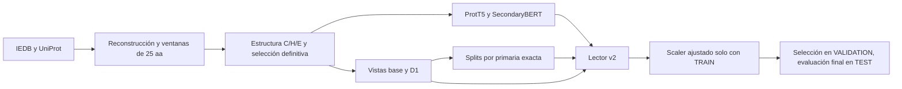

# Documentación de NAP-CNB

Tres documentos. Nada más.

| Documento | Qué contiene |
|---|---|
| **[PIPELINE.md](PIPELINE.md)** | Cómo se construye el dataset y cómo se ejecuta cada etapa: fuentes, ventanas, estructura secundaria, ProtT5, SecondaryBERT, D1 y particiones. Contratos, claves y comandos. |
| **[HISTORIAL.md](HISTORIAL.md)** | Qué se ha probado y qué salió: objetivo científico, experimentos históricos con sus cifras y sus límites, por qué se rehízo todo en v2, y la deuda técnica pendiente. |
| **[../CLAUDE.md](../CLAUDE.md)** | **El estado vigente del proyecto y las decisiones abiertas.** Tiene prioridad sobre estos dos cuando discrepen. |

Para los números de los experimentos: **[`results/RESULTADOS.md`](../results/RESULTADOS.md)**. Para los informes de auditoría: [`reports/audits/`](../reports/audits/README.md).

## El flujo, de un vistazo



## Dónde vive cada cosa

| Ruta | Contenido |
|---|---|
| `data_pipeline/scripts/` | Código por función: descarga, reconstrucción, estructura, embeddings, splits, verificación |
| `neural_network/` | Entrenadores MLP y regresión logística |
| `results/` | Artefactos certificados e informes. `RESULTADOS.md` resume los números |
| `reports/audits/` | Informes de auditoría, versionados |
| `data/` y `model/` | Datos, archivos comprimidos y pesos. Fuera de git |
| `env/` | Entornos Conda |
| `tests/` | Pruebas de integridad y de contrato |

## Nota sobre esta documentación

El 24 de noviembre de 2026 se refundieron **14 documentos en estos 3**. Los originales —`INDICE_EVIDENCIA.md`, `mlp_experiment_history.md`, `NAP_CNB_technical_history.md`, `nap_cnb_v2_dataset_organization.md`, `NAP_CNB_pipeline_refactoring_plan.md`, `NAP_CNB_v2_training_guide.md`, `NAP_CNB_v2_BLOSUM62_D2.md`, `NAP_CNB_v2_BLOSUM62_storage.md`, `nap_cnb_v2_prott5.md`, `nap_cnb_v2_secondarybert.md`, `nap_cnb_v2_organizacion.md`, `nap_cnb_v2_reutilizacion.md`, `nap_cnb_v2_consistencia_estructural.md` y `architecture/README.md`— **están en git**, recuperables con:

```sh
git show <commit-anterior>:docs/<fichero>.md
```
