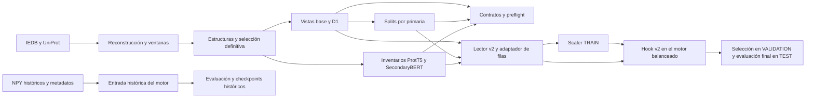

# Arquitectura de NAP-CNB

| Responsabilidad | Código y dependencias |
|---|---|
| Adquisición y antecedentes | [Scripts de descarga](../../data_pipeline/scripts/data_download/) y [auditorías de fuentes](../../data_pipeline/scripts/source_audits/). Los diagnósticos retienen evidencia sobre las fuentes. |
| Reconstrucción, estructuras y selección | [rebuild_iedb](../../data_pipeline/scripts/rebuild_iedb/) construye ventanas, concilia coordenadas y materializa la selección y las vistas mediante Parquet. |
| Etiquetas y datasets | [global_epitope_labels](../../data_pipeline/scripts/global_epitope_labels/) audita y agrega evidencia por primaria. [dataset_views.py](../../data_pipeline/scripts/rebuild_iedb/dataset_views.py) materializa las vistas. D1 usa `label_global` sobre el par exacto primaria–secundaria. |
| Splits | [split_nap_cnb_v2.py](../../data_pipeline/scripts/data_splitting/split_nap_cnb_v2.py) asigna por primaria exacta con semilla 42. La misma primaria conserva el split aunque cambie su estructura. El contrato admite proteínas y secuencias homólogas compartidas entre splits. |
| Embeddings | [ProtT5 v2](../../data_pipeline/scripts/embeddings/primary_structure/prott5_v2.py) mantiene shards NPY y recibos. [SecondaryBERT v2](../../data_pipeline/scripts/embeddings/secondary_structure/secondarybert_v2.py) mantiene un catálogo SQLite con referencias a archivos y vectores. |
| Contratos y preflight | [nap_cnb_v2.py](../../data_pipeline/nap_cnb_v2.py) cruza evidencia publicada, cabeceras y catálogos con lectura acotada. El CLI de entrenamiento devuelve un plan. |
| Lector y scaler v2 | [nap_cnb_v2_batches.py](../../data_pipeline/nap_cnb_v2_batches.py) proyecta grupos Parquet, resuelve claves y concatena ProtT5 (1.024) seguido de SecondaryBERT (768). El scaler reutiliza momentos por modalidad de [dataset.py](../../neural_network/MLP/dataset.py) y se ajusta solo con TRAIN. |
| Modelo, muestreo y recuperación | [Motor compartido](../../neural_network/MLP/mlp_layernorm_shuffled_ladder100_dualeval.py) posee el bucle balanceado, métricas y checkpoints. [LR balanceada](../../neural_network/logistic_regression/train.py) configura el motor histórico. El hook v2 se ejercitó con fixtures de CPU. |
| Lectura de bloques históricos | [block_reader.py](../../data_pipeline/block_reader.py) lee rangos en NPY directos con caché limitada. Sirve para auditoría independiente. El motor histórico conserva sus propias rutas de lectura. |

D1 está certificado. El scaler D1 de producción y el lanzamiento CLI v2 siguen pendientes. D2 sigue sin construir ni certificar. La política histórica de BLOSUM62 mantiene la etiqueta original como etiqueta heredada. [Estado de datasets](../nap_cnb_v2_dataset_organization.md) · [Guía de entrenamiento](../NAP_CNB_v2_training_guide.md) · [Auditoría BLOSUM62](../NAP_CNB_v2_BLOSUM62_D2.md)
